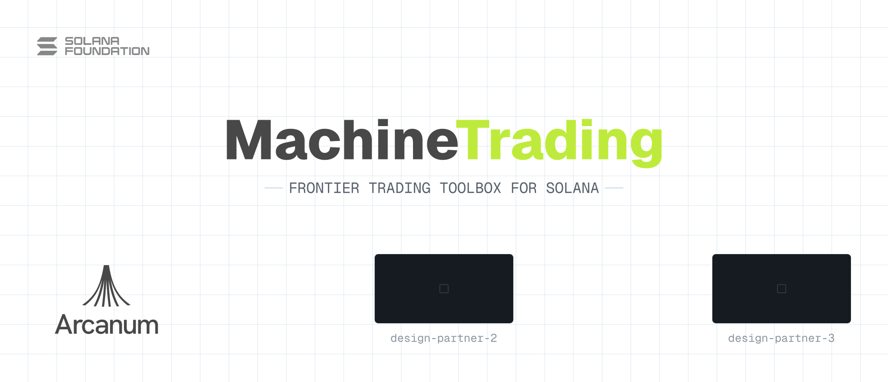

<div align="center">
  <picture>
    <source media="(prefers-color-scheme: dark)" srcset="docs/assets/banner-github-dark.png">
    <source media="(prefers-color-scheme: light)" srcset="docs/assets/banner-github-light.png">
    
  </picture>
</div>

<p align="center">
  <a href="https://hub.harborframework.com/datasets/solana-foundation/open-trading"></a>
</p>

**Open Trading is a workshop for frontier trading agents on Solana.** It
starts with a benchmark: agents write trading bots, and the bots are graded
on market scenarios replayed against an offline copy of Solana mainnet. Real
programs, real order books, and real fees run in a sandbox no bot can cheat.

The benchmark comes first because everything else needs it. A trading
harness is only as good as the scores that tell you it works, and a trading
model can only be trained against rewards that can be verified.

## 🧭 Where this is going

| Area | What it is | Status |
| --- | --- | --- |
| 📊 **Bench** | Harbor tasks where an agent writes a bot that's graded on hidden market scenarios. Each task is both an eval and an RL environment. | Shipping: [`bench/`](bench/) |
| 🛠️ **Harness** | An agent harness for trading on Solana: tools for market data, order entry and risk checks over [`ott-botkit`](crates/botkit), plus guardrails, running against the same sandboxes. | Next |
| 🧠 **Models** | Trading models trained on the bench: RL against task rewards, SFT on agent trajectories, evaluated on held-out scenarios. | Later |

Every area builds on the same core: the `ott` grader and simulator
([`crates/`](crates/)), reference bots ([`bots/`](bots/)), pinned mainnet
state ([`snapshots/`](snapshots/)), and the agent skills
([`skills/`](skills/)) that encode how to build all of the above.

## 📊 Bench

The [`solana-foundation/open-trading`](https://hub.harborframework.com/datasets/solana-foundation/open-trading)
dataset on Harbor Hub. Run it with [Harbor](https://harborframework.com):

```sh
# The whole dataset, three attempts per task, with Claude Code
harbor run -d solana-foundation/open-trading -a claude-code -m anthropic/claude-sonnet-5-5 -k 3

# One task
harbor run -d solana-foundation/open-trading -i solana-foundation/phoenix-flash-crash -a claude-code -m anthropic/claude-sonnet-5-5

# From a checkout: the reference solution, which should score 1.0
harbor run -p bench/tasks/phoenix-flash-crash -a oracle
```

In every task the agent writes a bot to `/app/bot`. The verifier then
receives only that bot, with no network, and for each hidden scenario:

1. Restores a pinned mainnet snapshot into a fresh, offline
   [Surfpool](https://github.com/solana-foundation/surfpool) surfnet, at
   the slot and time it was taken.
2. Funds a new trader, registers the scenario, and locks every cheatcode
   for good.
3. Starts the bot as an unprivileged user, behind an RPC proxy that forwards
   standard Solana methods only.
4. At the last slot, stops the bot and values its account on-chain.

The reward is the bot's total PnL over the hidden set divided by a reference
bot's, clamped to [0, 1]. Any refused RPC call, or a session that ends
liquidatable, scores 0.

### Tasks

Each task is a family of scenarios built from
[Surfpool's protocol templates](https://github.com/solana-foundation/surfpool/tree/main/crates/core/src/scenarios).
Phoenix comes first; other protocols follow.

#### 📉 Flash crash: `phoenix-flash-crash` ✅

SOL perps crash 5–12%. Most crashes rebound, some stall, and some keep
sliding. A good bot buys the forced selling and takes profit on the rebound
without letting the crashes that never recover eat its gains. Blind
dip-buying loses money overall. [Task →](bench/tasks/phoenix-flash-crash)

#### ⚖️ Market making: `phoenix-market-making` 🧪

Quote both sides of SOL perps while the oracle walks and jumps. Earn the
spread, and skew inventory before informed flow runs you over.
*Templates: oracle price, market move.*

#### 💸 Funding squeeze: `phoenix-funding-squeeze` 🧪

Funding rates spike against the crowded side. Harvest the carry, or get out
before it bleeds the account. *Templates: market funding.*

#### 🧯 Margin squeeze: `phoenix-margin-squeeze` 🧪

The exchange tightens risk factors mid-session. Deleverage in time, or get
liquidated. *Templates: market risk factors, max liquidation size.*

#### 🚦 Halts: `phoenix-halt` 🧪

The market goes cancel-only, halts, then resumes. Manage orders and exposure
through every state change. *Templates: market status, exchange status.*

#### 🧾 Fee regime: `phoenix-fee-regime` 🧪

Maker and taker fees change, and open interest hits its cap. Route between
resting and crossing orders as the economics shift. *Templates: market fees,
open interest cap.*

#### 🔮 Oracle divergence: `oracle-divergence` 🧪

A Pyth or Switchboard feed drifts away from the venue's mark. Trade the
convergence, and don't get caught by a feed that's simply wrong.
*Templates: Pyth, Switchboard, Phoenix oracle price.*

#### 🔀 Spot–perp basis: `spot-perp-basis` 🧪

Phoenix perps dislocate from spot on Jupiter, Raydium and Orca. Capture the
basis across venues, net of fees and slippage. *Templates: Jupiter, Raydium,
Whirlpool, Phoenix market move.*

#### 🏦 Leverage loop: `kamino-leverage-loop` 🧪

Run a looped lending position while borrow rates spike and reserve limits
change. Unwind before the loop turns on you. *Templates: Kamino reserves.*

#### 🚀 Token graduation: `pump-graduation` 🧪

Trade a token through its pump.fun bonding-curve graduation to the AMM,
where liquidity and price discovery change in a single slot. *Templates:
pump, pump-amm.*

✅ published · 🧪 planned

## 🗂️ Repository layout

```
open-trading/
├── bench/                 📊 the benchmark
│   ├── tasks/             Harbor dataset: dataset.toml + one directory per task
│   ├── checks/            cheating bots every task must score 0
│   └── image/             the images every task builds on: dev (agents) and runtime (verifiers)
├── crates/                🦀 shared Rust
│   ├── core/              ott-core: offline worlds, scenario families, RPC guard, sessions, grading
│   ├── cli/               ott: the grader and scenario generator
│   └── botkit/            ott-botkit: the SDK bots build on (ships in the task image)
├── bots/                  🤖 starter, reference (the oracle), and baselines
├── snapshots/             📸 pinned mainnet state (surfnet.json is gitignored)
├── skills/                🧠 agent skills: how to design great trading tasks
└── docs/                📐 architecture decision records (docs/adr) and assets
```

The harness and models will get top-level directories next to `bench/`,
sharing `crates/`, `bots/` and `snapshots/`.

## 🛠️ Hack on it

### Prerequisites

- Rust 1.97.1 (pinned in `rust-toolchain`), [`just`](https://github.com/casey/just),
  Docker with buildx, and [Harbor](https://harborframework.com) (`uv tool install harbor`).
- Nothing else: Cargo fetches Surfpool from the branch of
  [surfpool#902](https://github.com/solana-foundation/surfpool/pull/902)
  (cheatcode locks, SDK snapshots, clock restore) until it ships in a release.
- The snapshot's `surfnet.json`, which is too big for git:
  `just snapshot-pull` copies it out of the published task image. To fork a
  fresh one instead, put a mainnet RPC URL in `.env` as `OTT_FORK_RPC_URL`
  and run `just snapshot-prepare`.

### Everyday loop

```sh
just bots                                          # build every bot's bin/bot
just grade bots/reference bench/tasks/phoenix-flash-crash/environment/practice/*.json
just test lint                                     # unit tests and clippy
```

`ott grade` runs exactly what the verifier runs. Bot logs land in
`target/logs/`. Don't run heavy builds while grading: slots advance on the
wall clock, and a starved machine gives bots fewer looks per slot.

### Change a task

```sh
just scenarios DIR NAME 12 SEED        # draw a stratified scenario set
just calibrate DIR/*.json              # record the reference bot's PnL in each
just image && just harbor-checks       # oracle ≈ 1; nop, cheater, sneaky = 0
harbor check bench/tasks/<task>        # LLM review against Harbor's rubric
```

After changing `bots/reference`, run `just solution` and recalibrate every
scenario. Keep the seeds of hidden sets private: the files are the only copy.

### Add a task

Start with the [`trading-task-design`](skills/trading-task-design/SKILL.md)
skill. Claude Code loads it in this repo. It walks through the thesis
("a good bot profits here because it ___"), the scenario family, the
reference bot, the instruction contract, anti-cheat, market realism, and
calibration against real agents, and it ends with a pre-publish checklist.

### Release

Bump `tag` in the Justfile, build the images and run the checks on them
(`just image && just harbor-checks`), commit, then:

```sh
just release     # push both images (amd64 + arm64, ~40 min on Apple silicon),
                 # pin every task to its digest, lint, sync digests, publish
```

Commit the pins and digests it writes. CI checks every push (fmt, clippy,
tests, lint, calibrated scenarios), and builds the images and runs the
oracle through Harbor weekly.

## Known gaps

- The bot shares the verifier container with the surfnet. A bot that finds
  the surfnet's own port gets nothing from it (cheatcodes, airdrops and
  `exit` are all locked), but it could still compete for CPU. A sidecar
  container that can reach only the proxy would close this.
- Scenarios move the market along a scripted path, so makers don't react to
  the bot. Each task's README lists its realism limits.
- The hidden scenarios ship inside each public task. Treat public scores as a
  development signal. Rankings will come from a private, rotating held-out
  set ([ADR 0001](docs/adr/0001-public-and-held-out-scenarios.md)).
