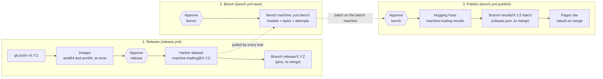
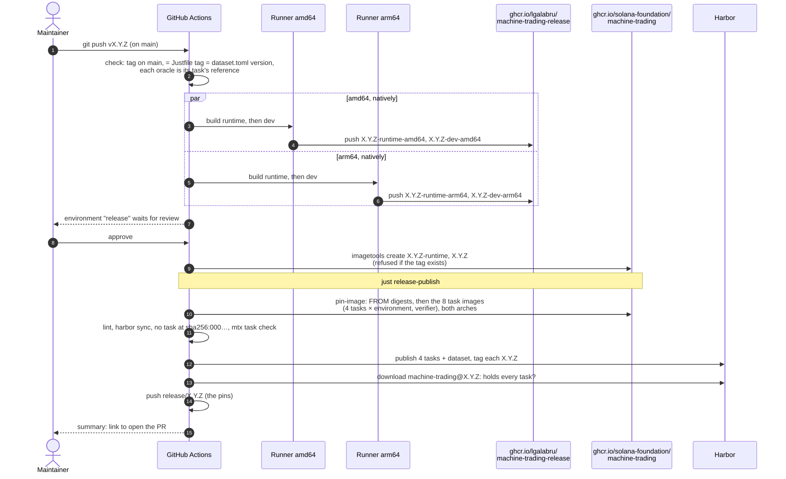
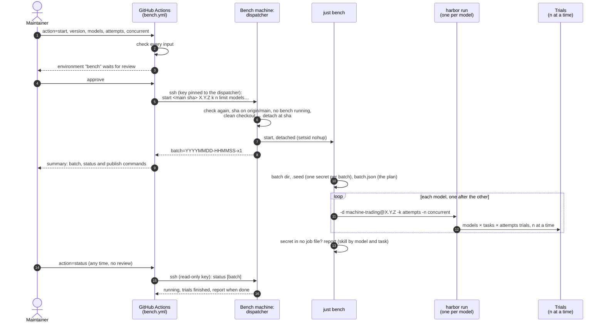
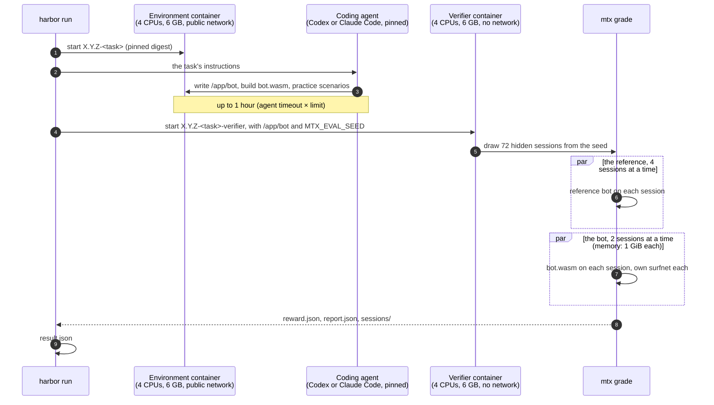
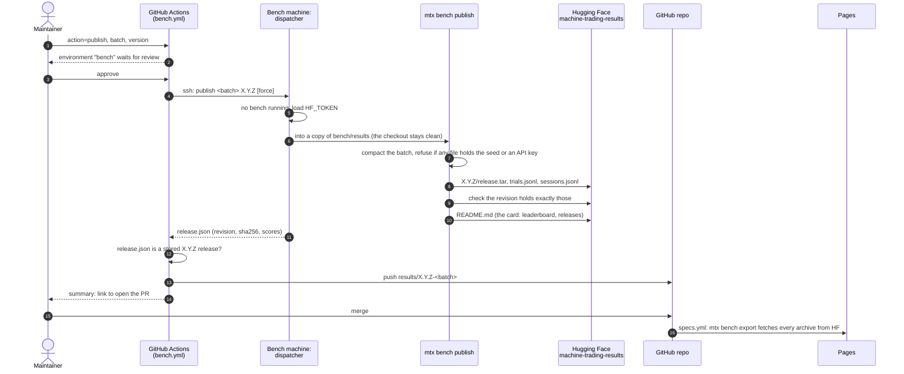

# Release and bench automation

How a version of the benchmark goes from a tag to published results: who
does what, in what order, what runs at the same time, and where each secret
lives. The commands are in [development.md](development.md#automation); why
GitHub reaches the bench machine over SSH is
[ADR 0002](adr/0002-bench-machine-over-ssh.md).

## The whole path

Three stages, each started by a person: a release, a bench, a publish. A
bench runs a released version only, so the tasks an agent sees are the ones
Harbor serves to everyone.

`status` (`bench.yml status`) can be asked at any time, without approval.

## 1. Release

A tag on main starts it. The image jobs need no secret, so they start at
once; the publish job is the only one that holds secrets, and it waits for
a reviewer.

What runs at the same time:

| Step | In parallel | Why it can |
| --- | --- | --- |
| Image builds | amd64 and arm64, on two native runners | separate machines, separate caches; merged by digest afterwards |
| Within a build | `cargo` with all the runner's cores | one build per machine |
| Task images | the 8 (4 tasks × environment, verifier), one after another, each for both arches | small: a `COPY` on the pinned image |
| Harbor publish | the 4 tasks' uploads at once (`--concurrency 50`) | independent packages |

From a laptop, `just release` does the same in one go; the images then
build for both arches on the laptop, amd64 under emulation (about 40
minutes on Apple silicon). A buildx node on the bench machine builds amd64
natively instead, in minutes: `docker buildx create --name mtx-amd64
--platform linux/amd64 ssh://<bench machine>`, then one `buildx build --platform
linux/amd64` there and one `linux/arm64` locally, merged with `docker buildx
imagetools create`. The registry login stays on the laptop: buildx lends it
to the remote builder for the build only.

## 2. Bench

### One trial

Each trial is two containers, one after the other, on their own Docker
networks. The agent never sees the verifier's container or the hidden set;
the verifier never reaches a network.

### What runs at the same time

| Level | In parallel | Limit | Set by |
| --- | --- | --- | --- |
| Models | one after the other in `just bench` | — | the recipe's loop |
| Trials of a model | `concurrent` at a time | the machine: 4 CPUs and 6 GB per container | `-n`, `bench.yml concurrent` |
| A trial's two phases | no: agent, then verifier | — | Harbor |
| Reference sessions | 4 at a time | trusted, small | `--anchor-jobs 4` |
| Bot sessions | 2 at a time (up to 4) | 1 GiB per strategy in 6 GB | `--jobs 4`, capped by memory |
| Sessions vs each other | isolated | a component has no files and no network | the grader |

Grades don't depend on load: sessions run on no clock, so a trial graded
alongside 39 others gets the report it would get alone (`mtx grade
--replay` checks it). Concurrency only changes how long a batch takes.

How long a batch takes, roughly: the agent's hour, then grading (about 15
minutes for flash-crash, longer for market-making), times the number of
waves (`ceil(models × tasks × attempts / concurrent)` per model, models in
turn). Two models × four tasks × five attempts at `concurrent` 20 is one
wave per model.

Each trial uses two Docker networks while it runs. Docker's default address
pools hold about 31, so the bench machine's Docker daemon is given a larger
private range (`default-address-pools`, with room for hundreds of /24s).
Without it, a batch of 40 trials fails at the 16th with "all predefined
address pools have been fully subnetted".

## 3. Publish

